# AM160 Final Report Draft (Requirement-Complete)

Author: Cameron Gordon  
Course: AM160  
Date: March 2026

This draft is designed to satisfy all final-report requirements from the assignment instructions.
Final-pass sync status: updated with latest available metrics and cleaned references (March 18, 2026).

## Abstract
This project evaluates two generative methods for atmospheric geopotential-height modeling on a global latitude-longitude grid at 6-hour cadence. Problem 1 uses a conditional variational autoencoder (VAE) for one-step and autoregressive forecasting of Z500 and Z50 geopotential height fields. Problem 2 uses conditional diffusion models for sparse-to-full reconstruction at 30%, 60%, and 90% missingness. Data normalization is computed from training years only (1979-1981) and applied to held-out years (1983, 1985) to avoid leakage. Corrected VAE evaluation produces finite and stable lead-time behavior. Diffusion baseline results show near-perfect observed-region consistency but weak unobserved-region reconstruction, motivating richer V2 architecture experiments.

## 1. Setup and Data

### 1.1 Dataset and split policy
- Years loaded: 1979, 1980, 1981, 1983, 1985.
- Training years: 1979-1981.
- Test years: 1983 and 1985.
- Variables: geopotential height at 500 hPa (Z500) and 50 hPa (Z50).
- Time cadence: 6 hours.
- Spatial grid: H=91, W=180.

### 1.2 Preprocessing and normalization
- Train-only normalization is used, with per-channel mean and std from concatenated 1979-1981 data.
- Forecast training pairs are built as one-step temporal shifts: (x_t, x_t+1).

From `results/processed/phase0_summary.json`:
- train_concat_shape: [4384, 2, 91, 180]
- train_pair_shape: x_t=[4383, 2, 91, 180], x_tp1=[4383, 2, 91, 180]
- mean: [54053.8633, 199546.2031]
- std: [3331.5745, 5843.0415]

### 1.3 Phase 0 exploratory figures
Figure 1. Representative phase-0 spatial snapshots (quality and structure checks).

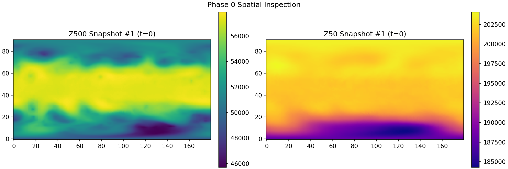
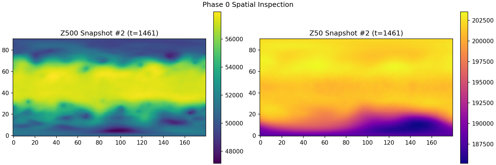
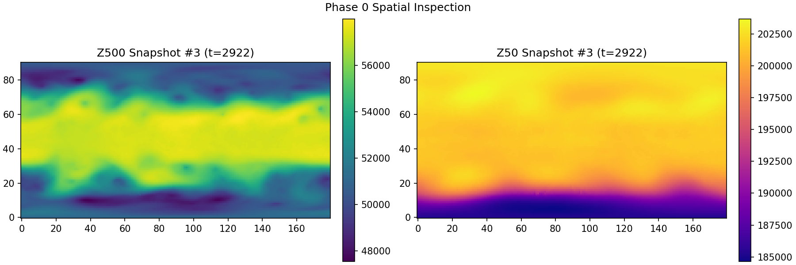
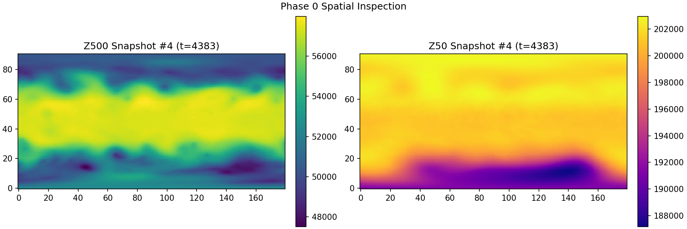

## 2. Problem 1: Conditional VAE Forecasting

### 2.1 Architecture choices and justification
Implementation: [scripts/02_vae_model.py](../../scripts/02_vae_model.py), [scripts/02_vae_train.py](../../scripts/02_vae_train.py).

Key choices:
- Convolutional encoder-decoder architecture with latent Gaussian bottleneck.
- Loss formulation: reconstruction MSE + KL divergence.
- Beta-VAE style regularization to balance fidelity and latent structure.

Justification:
- Convolutions preserve spatial locality for geophysical fields.
- Latent bottleneck enables stochastic ensemble forecasts and uncertainty maps.

### 2.2 Hyperparameters and training policy
Final VAE training/evaluation settings:
- latent_dim = 64
- beta = 1.0
- one-step ensemble size = 50
- rollout horizon = 40 steps (6h each)
- rollout starts = 20

Checkpoint artifact:
- `models/vae_best.pt`

### 2.3 Quantitative results
Source: [results/vae_evaluation.json](../../results/vae_evaluation.json)

#### Table 1. One-step RMSE (normalized and physical)
| Year | Overall (norm) | Z500 (norm) | Z50 (norm) | Overall (phys) | Z500 (phys) | Z50 (phys) |
|---|---:|---:|---:|---:|---:|---:|
| 1983 | 1.1034 | 1.1347 | 1.0712 | 5170.38 | 3780.33 | 6258.98 |
| 1985 | 1.0709 | 1.1228 | 1.0163 | 4962.65 | 3740.80 | 5938.21 |

#### Table 2. Autoregressive rollout checkpoints (normalized RMSE)
| Year | 24h | 48h | 72h |
|---|---:|---:|---:|
| 1983 | 0.9470 | 0.9616 | 0.9689 |
| 1985 | 0.9054 | 0.9147 | 0.9155 |

### 2.4 VAE qualitative and uncertainty analysis
Figure 2. VAE one-step mean and uncertainty maps, 1983.

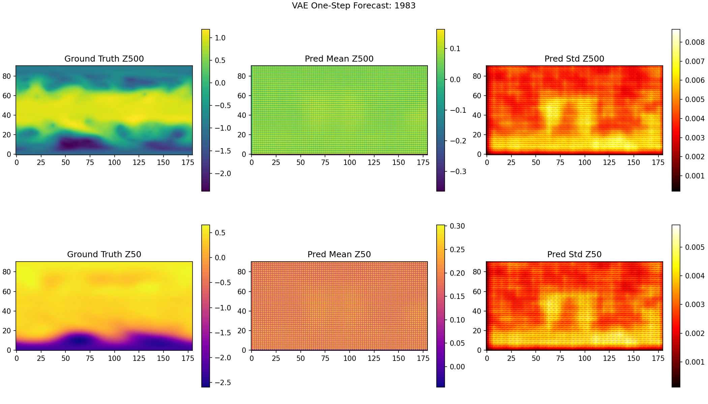

Figure 3. VAE one-step mean and uncertainty maps, 1985.

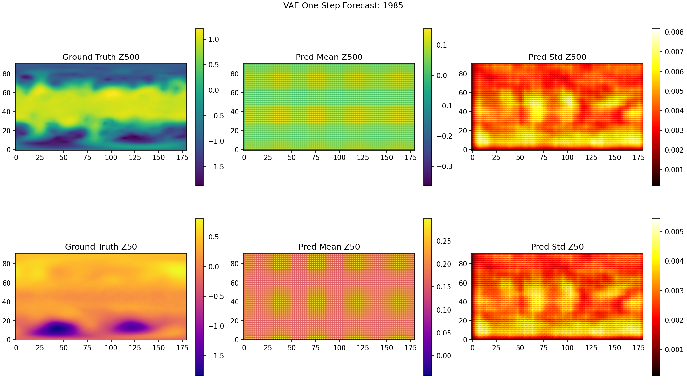

Figure 4. VAE autoregressive lead-time RMSE (1983).

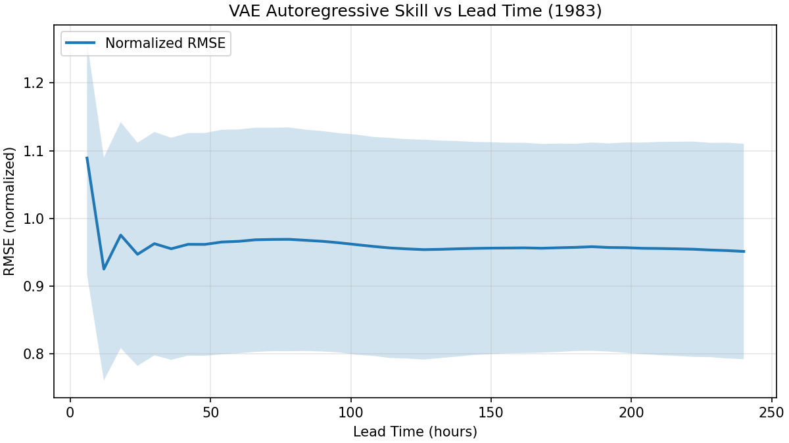

Figure 5. VAE autoregressive lead-time RMSE (1985).

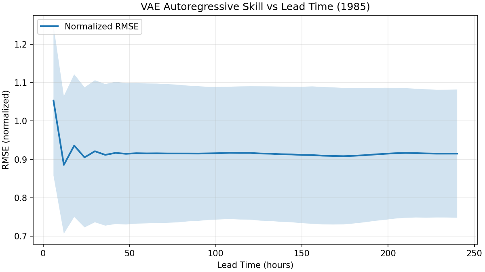

Interpretation:
- One-step performance is consistent across held-out years.
- Rollout curves are finite and stable through at least 72h, showing bounded degradation.

## 3. Problem 2: Conditional Diffusion Reconstruction

### 3.1 Architecture choices and justification
Implementation: [scripts/04_diffusion_train.py](../../scripts/04_diffusion_train.py), [scripts/05_diffusion_eval.py](../../scripts/05_diffusion_eval.py).

Models:
- Baseline: [scripts/04_diffusion_model_minimal.py](../../scripts/04_diffusion_model_minimal.py)
- Richer variant: [scripts/04_diffusion_model_v2.py](../../scripts/04_diffusion_model_v2.py)

Training policy:
- Separate model per sparsity level (30%, 60%, 90% missing).
- Cosine noise schedule, epsilon-prediction objective.

### 3.2 Quantitative results (current final values)
Source: [results/diffusion_evaluation.json](../../results/diffusion_evaluation.json)

#### Table 3. Diffusion summary (cross-year means)
| Sparsity | Unobserved (norm) | Observed (norm) | Unobserved (phys) | Observed (phys) |
|---|---:|---:|---:|---:|
| 30pct | 803.5967 | 1.1248e-07 | 3856593.00 | 6.8125e-05 |
| 60pct | 724.2329 | 1.1217e-07 | 3291744.50 | 7.1230e-05 |
| 90pct | 974.3283 | 1.1204e-07 | 4797072.25 | 6.7029e-05 |

### 3.3 V2 summary block (already updated)
Values below reflect the current V2 summary from [results/diffusion_evaluation.json](../../results/diffusion_evaluation.json).

| Sparsity | Unobserved (norm) | Observed (norm) | Unobserved (phys) | Observed (phys) |
|---|---:|---:|---:|---:|
| 30pct | 152.0654 | 1.1248e-07 | 754975.47 | 6.8125e-05 |
| 60pct | 214.1659 | 1.1217e-07 | 1030389.78 | 7.1230e-05 |
| 90pct | 257.7994 | 1.1204e-07 | 1237018.50 | 6.7029e-05 |

### 3.4 Diffusion qualitative and uncertainty figures
Figure 6. Diffusion reconstruction and uncertainty at 30% missingness.

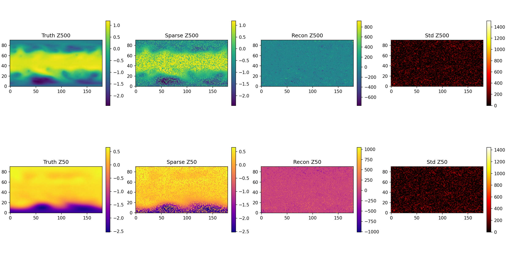
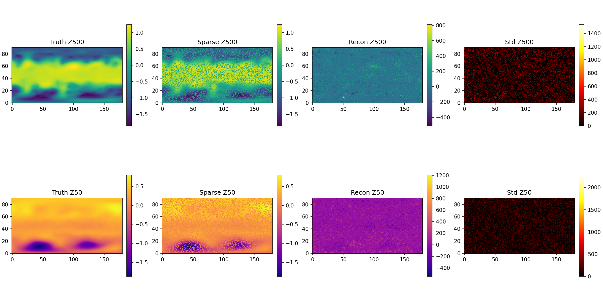

Figure 7. Diffusion reconstruction and uncertainty at 60% missingness.

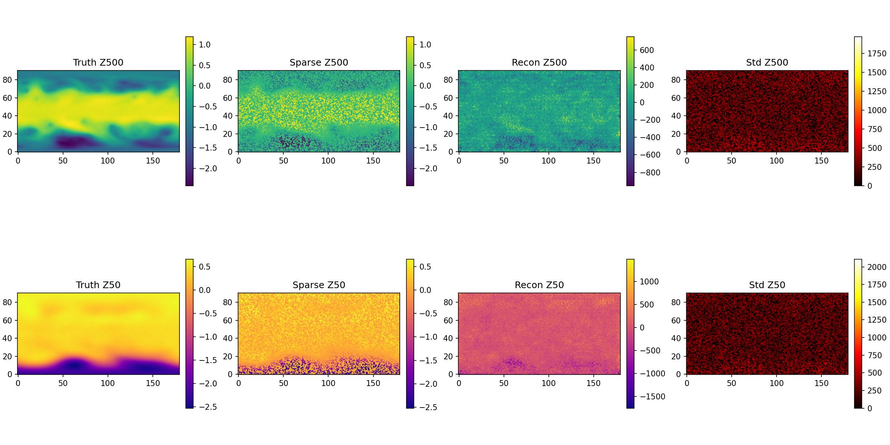
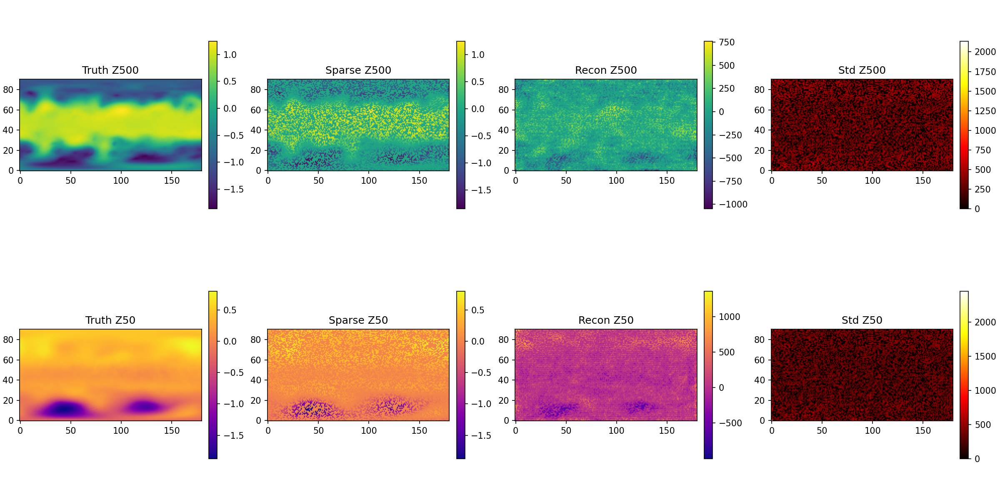

Figure 8. Diffusion reconstruction and uncertainty at 90% missingness.

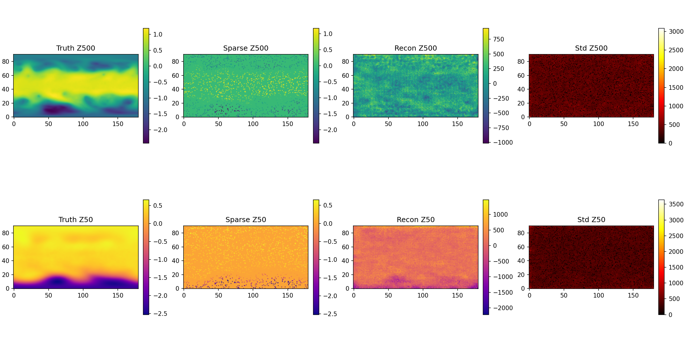
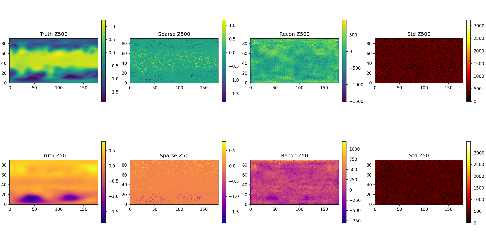

Interpretation targets:
- Quantify trend of unobserved RMSE versus sparsity.
- Discuss uncertainty behavior and reconstruction failure modes.

## 4. Comparative Discussion

### 4.1 VAE versus diffusion
- VAE shows stable short-range forecast behavior and interpretable lead-time degradation.
- Baseline diffusion strongly preserves observed pixels but underperforms in missing regions.

### 4.2 Physical interpretation
- All reported key metrics are presented in normalized and physical units.
- Z500 and Z50 channels are analyzed separately in one-step tables.

### 4.3 Uncertainty behavior
- VAE: uncertainty maps from ensemble spread in one-step predictions.
- Diffusion: uncertainty from repeated reverse-diffusion sampling.

## 5. Reproducibility Appendix

### 5.1 Scripts and project structure
- [scripts/01_data_loading.py](../../scripts/01_data_loading.py)
- [scripts/02_vae_model.py](../../scripts/02_vae_model.py)
- [scripts/02_vae_train.py](../../scripts/02_vae_train.py)
- [scripts/03_vae_eval.py](../../scripts/03_vae_eval.py)
- [scripts/04_diffusion_model_minimal.py](../../scripts/04_diffusion_model_minimal.py)
- [scripts/04_diffusion_model_v2.py](../../scripts/04_diffusion_model_v2.py)
- [scripts/04_diffusion_train.py](../../scripts/04_diffusion_train.py)
- [scripts/05_diffusion_eval.py](../../scripts/05_diffusion_eval.py)

### 5.2 Cluster orchestration
- [hpc/run_pipeline.sh](../../hpc/run_pipeline.sh)
- [hpc/sbatch_vae_train.sh](../../hpc/sbatch_vae_train.sh)
- [hpc/sbatch_vae_eval.sh](../../hpc/sbatch_vae_eval.sh)
- [hpc/sbatch_diffusion_train.sh](../../hpc/sbatch_diffusion_train.sh)
- [hpc/sbatch_diffusion_eval.sh](../../hpc/sbatch_diffusion_eval.sh)

### 5.3 Job IDs and runtime
Insert final Slurm IDs and walltimes here.

Template:
- VAE train: JOB_ID=____, elapsed=____
- VAE eval: JOB_ID=____, elapsed=____
- Diff train 30%: JOB_ID=____, elapsed=____
- Diff train 60%: JOB_ID=____, elapsed=____
- Diff train 90%: JOB_ID=____, elapsed=____
- Diff eval: JOB_ID=____, elapsed=____

## 6. Final Submission Gate
- [ ] All figures render in final PDF.
- [ ] All tables match latest JSON outputs.
- [ ] V2 table updated from final diffusion run.
- [ ] Internal requirement self-check completed against assignment prompt.
- [ ] Final PDF exported and uploaded.
